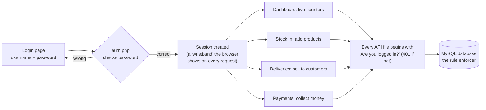
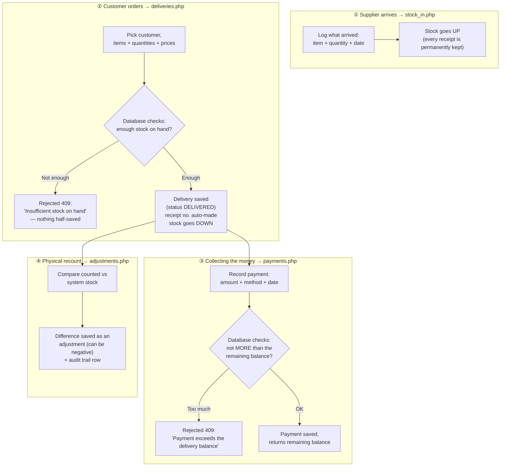
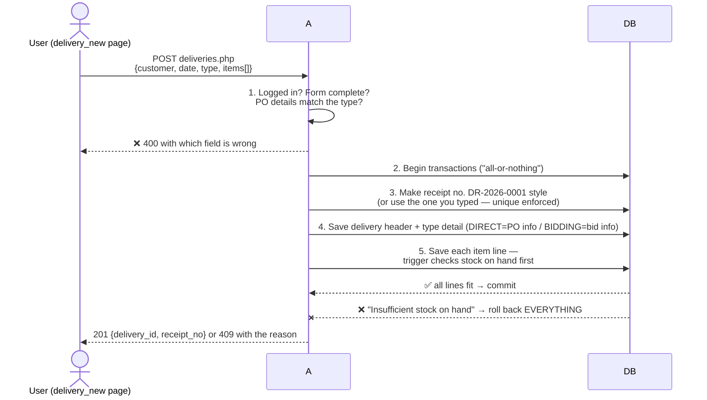
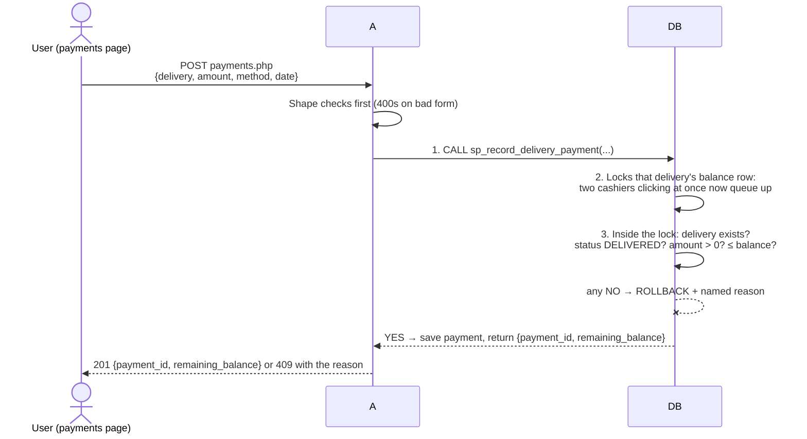

# PMS Trading — API Guide (Plain-English + Flow Diagrams)

This is the single source of truth for how every page talks to the server.
Everything below is written so a non-programmer can follow the flow, while
developers/AI agents get the exact facts they need.

> **The one-sentence version:** every page sends small JSON messages to an
> `api/*.php` file, the server checks "are you logged in?" and "is this data
> valid?", the database enforces the real business rules (never oversell,
> never overpay), and the server answers back with JSON — or a numbered error
> the page can explain to the user.

---

## 1. The big picture — how a login turns into anything else



- The browser keeps a **session** (think of it as a wristband stamped at the
  door). Lose it — logged-out, idle-out — and every request gets answered
  `401 Authentication required`, and the page JS sends you back to
  `login.html` automatically.
- **The database is the last line of defense.** Even if a page bug tried
  something wrong, view/trigger/procedure rules inside MySQL reject it, and
  the server translates that rejection into a clean, human-sounding error
  (see §3).

---

## 2. Ground rules every page and endpoint follow

| Rule | Plain meaning |
| :--- | :--- |
| Every `api/*.php` starts with `require_once __DIR__ . '/_bootstrap.php';` | Load the shared toolkit first (session check, JSON sender, error translator). |
| Every endpoint except `auth.php` login checks login first (`require_login()`) | No wristband, no service — always `401`. |
| Everything entered/returned is JSON | The page posts a JSON "form"; the server answers a JSON "receipt". |
| Dates look like `YYYY-MM-DD` | e.g. `2026-11-09`. |
| Choices are stored UPPERCASE in the database | `ACTIVE`, `SCHOOL`, `OFFICE`, `DIRECT`, `BIDDING`, `DELIVERED`, `CANCELLED`, `CASH`… |
| Money answers as plain numbers | e.g. `10460` or `1499.5` — the page adds the ₱ sign and commas. |
| Invalid input never leaks database complaints | Pages check the form first (→ `400`); database rejections come back as clear `409` messages. |

### What the status codes mean in human words

| Code | Name | Human words |
| :--- | :--- | :--- |
| 200 | OK | "Here's what you asked for." |
| 201 | Created | "Saved it — here's the new record number." |
| 400 | Bad request | "The form wasn't filled in right — fix these." |
| 401 | Unauthenticated | "You aren't logged in." |
| 404 | Not found | "That record doesn't exist (or was already deleted/archived)." |
| 409 | Conflict | "Legally can't do that — e.g. delivery would oversell, payment too big, name-already-used." (Also maps database rule rejections here.) |
| 500 | Server error | Escapes only for genuinely unexpected problems. |

Shared toolkit in `config/db.php` (single reusable database connection) and
`api/_bootstrap.php` (`json_ok()`, `json_err()`, `require_login()`, `body()`,
`int_param()`, `str_param()`, plus the error translator: database rule
rejections "45000/23000" → clean `409`).

---

## 3. The life of the stock — one diagram for the whole business



**Why some deliveries can't be deleted/undone the naive way:** history is
append-only. Fixes happen as *new* records on top — a cancellation (which
restores the stock), an adjustment, or a refund-style correction — so past
records always tell the truth about what happened.

---

## 4. The two hero workflows, step by step

### 4.1 Creating a delivery (`deliveries.php` POST) — saved all-or-nothing



Guarantees: a failed delivery leaves **zero** partial rows (no phantom
delivery, no half-deducted stock). Cancelling a DELIVERED delivery is a
dedicated status change (`PUT {status: 'CANCELLED'}`, only allowed while no
payments exist) — the stock views automatically stop counting it, so its
quantities return to available stock.

### 4.2 Recording a payment (`payments.php` POST) — race-proof by design



The stored procedure (06_procedures) is the ticket booth: only one payment
gets "in" for a given balance per instant, so double-clicks and slow-network
retries can never charge an office twice. An overpay *trigger* stays as a
backstop. `DELETE` on a payment is intentionally not offered — corrections
are new records so the money trail stays honest.

### 4.3 Deleting things that have history (items, stock-in receipts, customers, categories)

```mermaid
flowchart LR
    Q{Delete requested} -->|"never used anywhere"| H["Really removed (200)"]
    Q -->|"used in real history"| ARCH["Kept, just flagged:<br/>item → status ARCHIVED<br/>others → 409 'has records'"<br/>(history preserved)"]
    Q -->|"removing a stock-in receipt<br/>would make stock go negative"| G["409 — refused by<br/>the stock-in delete guard"]
```

---

## 5. Endpoint reference — what to ask, what you get

Each block: what it's for → the requests → exact response fields. All except
`auth.php` require the login session.

### 5.1 `api/auth.php` — the door
| Ask | Body / Query | Get back |
| :--- | :--- | :--- |
| `POST` | `{username, password}` | `{user_id, username, full_name}` — session starts |
| `GET ?action=me` | — | same fields; `401` when not logged in |
| `GET ?action=logout` | — | `{ok: true}` — session destroyed |

### 5.2 `api/items.php` — the product catalog
| Ask | Body / Query | Get back |
| :--- | :--- | :--- |
| `GET` | optional `?search=` (code or name), `?category=`, `?status=`, `?low_stock=1` | list from the live stock view: `{item_id, item_code, name, category, unit, unit_price, low_stock_level, status, stock_on_hand}` — note the list view carries the category **name**, not its id; sorted by name |
| `GET ?id=N` | — | single item + `price_history: [{effective_at, price}]` |
| `POST` | `{category_id, item_code, name, unit, unit_price, low_stock_level}` | `{item_id}` — starting price auto-enrolls in the price history |
| `PUT ?id=N` | any of `{category_id, name, unit, unit_price, low_stock_level, status}` | updated item; a price change auto-writes a history row |
| `DELETE ?id=N` | — | archived (→ `{archived: true}`) when it has movement history, else hard-deleted |

### 5.3 `api/categories.php` — product groupings
`GET` (list with item counts) · `POST {name}` → `{category_id}` · `PUT ?id=N {name}` ·
`DELETE ?id=N` → `409 "Category has items"` when still used by products.

### 5.4 `api/customers.php` — schools & offices
| Ask | Body / Query | Get back |
| :--- | :--- | :--- |
| `GET` | optional `?type=SCHOOL\|OFFICE`, `?search=` | merged list: `{customer_id, name, address, customer_type, school_level?/head_name?, office_type?/contact_person?, contacts: [{contact_type, contact_value}]}` |
| `GET ?id=N` | — | same shape + `outstanding` (unpaid balance across that customer's deliveries) |
| `POST` | `{name, address, customer_type, + subtype fields, + contacts}` | `{customer_id}` — saved all-or-nothing |
| `PUT ?id=N` | same fields | updated (subtype details and contacts replaced atomically) |
| `DELETE ?id=N` | — | `409 "Customer has deliveries"` if delivery history exists |

### 5.5 `api/stock_in.php` — the "arrival log"
| Ask | Body / Query | Get back |
| :--- | :--- | :--- |
| `GET` | optional `?item_id=`, `?from=`/`?to=` | receipts joined with item name/code, newest first |
| `POST` | `{item_id, quantity, date_received, remarks?}` | `{stock_in_id}` — quantity must be > 0, stock goes up |
| `DELETE ?id=N` | — | removed **only if** the stock wouldn't dip negative — otherwise `409` |

### 5.6 `api/stock_card.php` — the old paper stock card, digital
| Ask | Body / Query | Get back |
| :--- | :--- | :--- |
| `GET` (no item chosen) | — | `{items: [{item_id, item_code, name, unit, stock_on_hand}]}` for the picker |
| `GET ?item_id=N` | optional `&from=&to=` | `{item: {...}, entries: [{move_date, move_type (IN\|OUT\|ADJ), qty (signed), balance}]}` — chronological running balance, oldest first (same-day: IN before OUT before ADJ) |

### 5.7 `api/deliveries.php` — the sales book (see §4.1)
| Ask | Body / Query | Get back |
| :--- | :--- | :--- |
| `GET` | `?status=`, `?order_type=`, `?customer_id=`, `?from=`/`?to=`, `?unpaid=1` | list joined with customer names + PO/bid details + computed `total` / `paid` / `balance` |
| `GET ?id=N` | — | full record: header + `items[]` (each with `line_total`) + `payments[]` + totals |
| `POST` | `{customer_id, delivery_date, order_type: DIRECT\|BIDDING, po_number?+po_date? / bid_ref_no?+delivery_deadline?, items[{item_id, quantity, unit_price}] (≥1)}` | `{delivery_id, receipt_no}` — receipt auto-generated `DR-{Y-m}-{seq}` when not supplied |
| `PUT ?id=N` | `{status: 'CANCELLED'}` (only while unpaid) | cancelled — stock restored by the views |
| `DELETE ?id=N` | — | only when no payments; items/subtype detail cascade |

### 5.8 `api/payments.php` — the collections book (see §4.2)
| Ask | Body / Query | Get back |
| :--- | :--- | :--- |
| `GET` | `?delivery_id=`, `?customer_id=`, `?from=`/`?to=` | payments joined with receipt no. + customer name |
| `POST` | `{delivery_id, amount, payment_date, method: CASH\|CHECK\|BANK TRANSFER\|OTHER, reference_no?, remarks?}` | `{payment_id, remaining_balance}` — overpayment → `409` with the exact reason |

### 5.9 `api/adjustments.php` — the physical count notebook
| Ask | Body / Query | Get back |
| :--- | :--- | :--- |
| `GET` | optional `?item_id=`, `?from=`/`?to=` | `{adjustment_id, item_id, item_code, name, adjust_date, system_qty, counted_qty, variance, reason}` — newest first; variance may be negative (shrinkage) |
| `POST` | `{item_id, counted_quantity, adjust_date, reason?}` | saved with `system_qty` = current stock on hand; 201 |

Every adjustment also auto-writes an untouchable audit-trail row
(`item_stock_audit`): what changed, by how much, and the new balance — from
*any* write path, including direct database edits.

### 5.10 `api/dashboard.php` — the morning-glance panel
One `GET` returns every counter the dashboard paints:

| Group | Fields |
| :--- | :--- |
| Catalog | `active_items`, `item_count`, `low_stock_items` (+ `low_stock` array, worst-stock-first, max 50) |
| Stock | `inventory_valuation` (Σ stock × price), `stock_on_hand_units` |
| Revenue | `revenue_total_ytd`, `revenue_this_month`, `revenue_trend` (last 6 months `{ym, revenue, deliveries}`, months with zero sales filled in) |
| Collection | `collected_ytd`, `outstanding` (Σ positive balances, DELIVERED only) |
| Activity | `deliveries_this_year`, `top_items` (top 5 `{name, qty_out}`, last 90 days), `schools`, `offices` |

### 5.11 `api/reports.php` — period accounting
| Ask | Get back |
| :--- | :--- |
| `GET ?report=matrix&from=&to=` | one row per item: `{item_code, name, unit, category, beginning, in_qty, out_qty, adj, ending}` where **ending = beginning + in − out + adj**; only items touched in the period, grouped by category then name |
| `GET ?report=summary&from=&to=` | `{revenue, collected, deliveries_count, outflow_value}` |
| `GET ?report=revenue&from=&to=` | monthly `{ym, revenue, collected, deliveries_count}` rows |

### 5.12 `api/receipt.php` — the printable delivery receipt (not JSON!)
`GET ?id=N` in the browser (a normal page you navigate to, not a JSON call —
`404` if the delivery doesn't exist, `401` without login). Renders a
standalone printable A4 receipt: header "PMS TRADING", receipt no., customer
block, the item table (qty, unit, price, line total), totals, payments
applied, remaining balance, and auto-opens the browser print dialog on load.
A "Back" link is provided but hidden when printing.

---

## 6. Front-end contract — building blocks pages must reuse

- **`js/api.js` → global `wb`** — the only way pages call the API:
  `wb.get('items.php')` / `wb.post(...)` / `wb.put(...)` / `wb.del(...)`.
  Paths omit `api/` (prepended automatically). Any `401` answer bounces the
  user to `login.html` automatically.
- **`js/ui.js` → global `UI`** —
  `shell(activePage)` (sidebar + topbar; call first on every page),
  `guard()` (redirect to login when needed; await it first),
  `esc`, `money` (₱), `date`, `toast`, `confirm` (promise),
  `modal({title, bodyHTML, footerHTML})`, `badge`,
  `setSelectValue(el, value, fallbackText)` (type-safe preselect for edit forms),
  `addSearch(input, tbody)` (search box that survives table re-renders).
- **`css/app.css`** — the whole design system (layout, cards/KPIs, tables,
  buttons, forms, badges, toasts, modals, search field, print). Pages use
  these classes only; nothing else ships styling.
