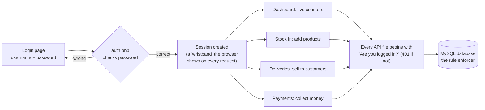
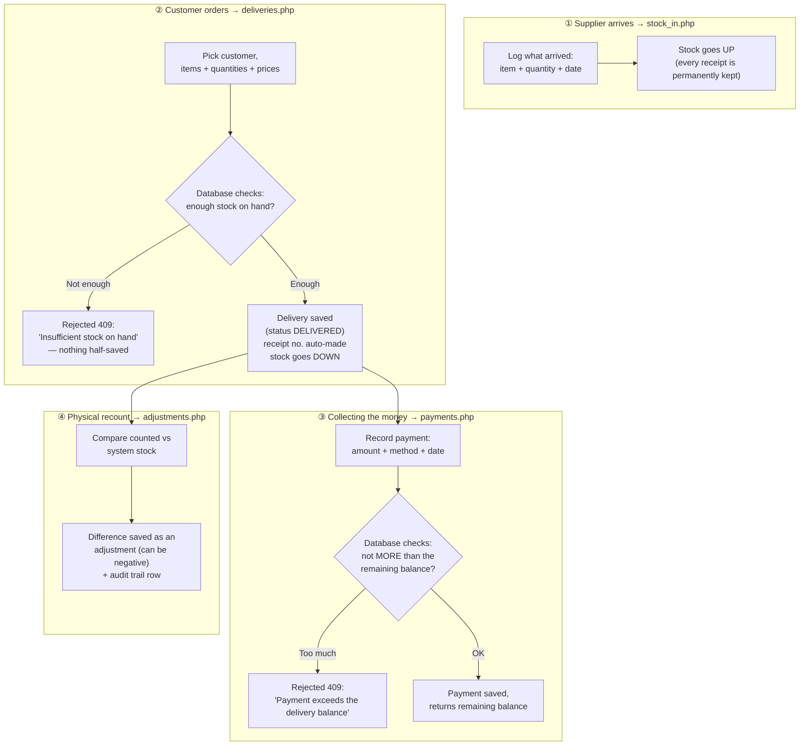
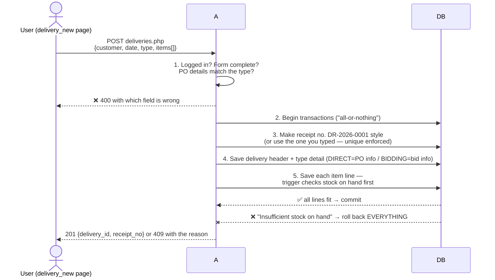
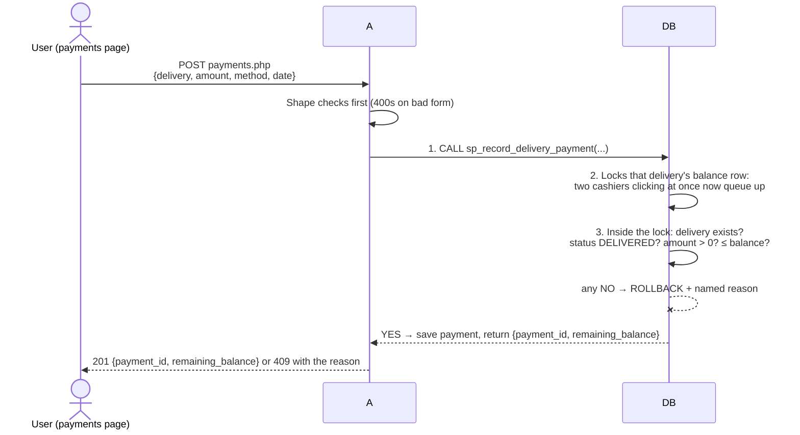
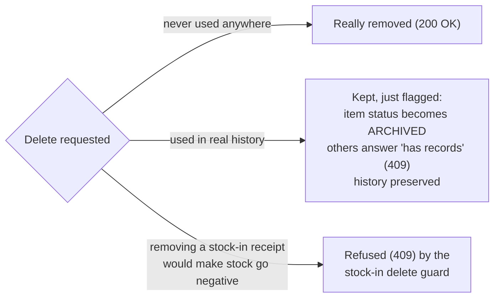

# PMS Trading — API Guide (Plain-English + Flow Diagrams + Presenter Scripts)

This is the single source of truth for how every page talks to the server.
Everything below is written so a non-programmer can follow the flow, while
developers/AI agents get the exact facts they need.

> **The one-sentence version:** every page sends small messages to an
> `api/*.php` file, the server checks "are you logged in?" and "is this data
> valid?", the database enforces the real business rules (never oversell,
> never overpay), and the server answers back — or a numbered error
> the page can explain to the user.

Each section ends with a 🎤 **script** — the exact words to say when
presenting that flow, in plain language (where the data goes, what the file
does to it, and where it proceeds next).

---

## 1. The big picture — how a login turns into anything else

- The browser keeps a **session** (think of it as a wristband stamped at the
  door). Lose it — logged-out, idle-out — and every request is answered
  `401 Authentication required`, and the page JS sends you back to
  `login.html` automatically.
- **The database is the last line of defense.** Even if a page bug tried
  something wrong, view/trigger/procedure rules inside MySQL reject it, and
  the server translates that rejection into a clean, human-sounding error
  (see §3).

> 🎤 **Script — the opening:** "First, the user logs in on the login page.
> The login page sends the username and password to a file called
> `auth.php`. That file checks the password against the database. If it is
> wrong, you go back to the login page. If it is correct, the server gives
> the browser a session — think of it like a wristband at an event. From
> then on, every time a page needs information — the dashboard, the items
> list, the deliveries, the payments — it knocks on its matching file inside
> the `api` folder, and the very first thing that file asks is 'are you
> wearing the wristband?'. If not, you are politely sent back to the login
> page. If yes, the file reads from or writes to our MySQL database, and the
> database itself is the final referee: it physically refuses anything that
> would oversell stock or overcharge a customer."

---

## 2. Ground rules every page and endpoint follow

| Rule | Plain meaning |
| :--- | :--- |
| Every `api/*.php` starts with `require_once __DIR__ . '/_bootstrap.php';` | Load the shared toolkit first (session check, JSON sender, error translator). |
| Every endpoint except `auth.php` login checks login first (`require_login()`) | No wristband, no service — always `401`. |
| Everything entered/returned is JSON | The page posts a JSON "form"; the server answers a JSON "receipt". |
| Dates look like `YYYY-MM-DD` | e.g. `2026-11-10`. |
| Choices are stored UPPERCASE in the database | `ACTIVE`, `SCHOOL`, `OFFICE`, `DIRECT`, `BIDDING`, `DELIVERED`, `CANCELLED`, `CASH`… |
| Money answers as plain numbers | e.g. `10460` or `1499.5` — the page adds the ₱ sign and commas. |
| Invalid input never leaks database complaints | Pages check the form first (→ `400`); database rejections come back as clear `409` messages. |

### What the status codes mean in human words

| Code | Name | Human words |
| :--- | :--- | :--- |
| 200 | OK | "Here's what you asked for." |
| 201 | Created | "Saved it — here's the new record number." |
| 400 | Bad request | "The form wasn't filled in right — fix these." |
| 401 | Unauthenticated | "You aren't logged in." |
| 404 | Not found | "That record doesn't exist (or was already deleted/archived)." |
| 409 | Conflict | "Legally can't do that — e.g. delivery would oversell, payment too big, name-already-used." (Also maps database rule rejections here.) |
| 500 | Server error | Escapes only for genuinely unexpected problems. |

Shared toolkit in `config/db.php` (single reusable database connection) and
`api/_bootstrap.php` (`json_ok()`, `json_err()`, `require_login()`, `body()`,
`int_param()`, `str_param()`, plus the error translator: database rule
rejections "45000/23000" → clean `409`).

> 🎤 **Script — the ground rules:** "All our files share one toolkit, so
> they behave the same way. Every file that is not the login file starts by
> checking the wristband. Information travels in and out as JSON — just
> structured text — and the server's answer carries a number: 200 means
> 'here is what you asked for', 201 means 'saved, here is the new record
> number', 400 means 'your form was not filled in right', 401 means 'you are
> not logged in', and 409 means 'I cannot legally do that' — for example,
> that would oversell our stock or overpay a delivery. Dates are saved as
> year-month-day, and money comes back as plain numbers that the page formats
> into pesos."

---

## 3. The life of the stock — one diagram for the whole business

**Why some deliveries can't be deleted/undone the naive way:** history is
append-only. Fixes happen as *new* records on top — a cancellation (which
restores the stock), an adjustment, or a refund-style correction — so past
records always tell the truth about what happened.

> 🎤 **Script — the story of one box of ballpens:** "Everything starts at
> the supplier. When products arrive, the owner logs them in
> `stock_in.php`: item, quantity, date. That file saves the arrival as a
> permanent receipt and the product's stock goes **up** — it never gets
> deleted, because we keep the whole story. Next, when a customer orders,
> the delivery form sends everything to `deliveries.php`. That file hands
> the order to the database, and the database's own check asks: do we
> *really* have enough on hand? If not, the whole order is refused with
> 'insufficient stock on hand' and nothing half-saves. If yes, the delivery
> is saved with a printed-style receipt number and the stock goes **down**.
> After that, money flows: payments go to `payments.php`, which checks the
> amount is never more than what is still owed. And every so often the owner
> does a physical count in `count.html`; `adjustments.php` saves the
> difference — even a shortage — and each one writes an untouchable
> audit-trail row. So stock math always ends with:
> beginning + arrivals − out + adjustments = ending."

---

## 4. The two hero workflows, step by step

### 4.1 Creating a delivery (`deliveries.php` POST) — saved all-or-nothing

Guarantees: a failed delivery leaves **zero** partial rows (no phantom
delivery, no half-deducted stock). Cancelling a DELIVERED delivery is a
dedicated status change (`PUT {status: 'CANCELLED'}`, only allowed while no
payments exist) — the stock views automatically stop counting it, so its
quantities return to available stock.

> 🎤 **Script — creating a delivery:** "When the owner presses save on the
> new-delivery form, the browser sends the whole order — the customer, the
> date, whether it is a direct order or a bidding job, and every item line
> — in one package to `deliveries.php`. That file first does the cheap
> checks itself: is the form complete, and did a direct order bring its PO
> details or a bidding order its bid reference? Anything missing bounces
> back immediately with an exact message. Then it opens an
> all-or-nothing transaction: it either generates the receipt number like
> DR-2026-0001 or takes the one typed in, saves the delivery header, saves
> the order-type details, and saves each item line — and on every single
> line, a database rule double-checks the stock. The moment any line
> doesn't fit, everything is rolled back — no half-delivery, no
> half-deducted stock. Only when every line passes does it commit and hand
> back the delivery number and receipt number, and this appears instantly
> in the Deliveries list."

### 4.2 Recording a payment (`payments.php` POST) — race-proof by design

The stored procedure (06_procedures) is the ticket booth: only one payment
gets "in" for a given balance per instant, so double-clicks and slow-network
retries can never charge an office twice. An overpay *trigger* stays as a
backstop. `DELETE` on a payment is intentionally not offered — corrections
are new records so the money trail stays honest.

> 🎤 **Script — collecting a payment:** "When a customer pays, the money
> page sends the delivery number, the amount, the method — cash, check,
> bank transfer, or other — plus the date to `payments.php`. Our file does
> its quick form checks, then makes a single call into the database: a
> procedure called `sp_record_delivery_payment`. Inside the procedure, the
> delivery's balance row is locked first — imagine a ticket booth door that
> only lets one cashier in at a time. So even if the owner clicks save
> twice fast, or the internet echoes the same payment twice, the second one
> waits its turn — and by then it sees the balance already dropped, so an
> overpayment is refused with exactly the reason. If everything passes, the
> payment is saved and the file answers with the payment number and the new
> remaining balance in one go. And there is no delete on payments by
> design: corrections are entered as new records, so the money trail is
> always honest."

### 4.3 Deleting things that have history (items, stock-in receipts, customers, categories)

Rule of thumb: **history is never falsified.** A product that sold before
is archived, not erased; a stock-in receipt that would make today's stock go
negative by disappearing is refused outright.

> 🎤 **Script — deleting safely:** "When someone presses delete, the file
> first asks: has this thing ever been used in real history? If it was
> never used — say a brand-new item with no receipts and no sales — it is
> really removed. But if it has history, the system refuses to erase it: an
> old item simply flips to 'archived' so it stops showing up in day-to-day
> pages but its old receipts and sales still read perfectly; a customer
> with past deliveries answers 'cannot delete — has records'. And a stock-in
> receipt is only removable if removing it would not make today's stock go
> negative — the database itself refuses with a clear conflict message.
> That is how we make sure no past record can ever lie about what really
> happened."

---

## 5. Endpoint reference — what to ask, what you get

Each block: what it's for → the requests → exact response fields → 🎤 script.
All except `auth.php` require the login session.

### 5.1 `api/auth.php` — the door
| Ask | Body / Query | Get back |
| :--- | :--- | :--- |
| `POST` | `{username, password}` | `{user_id, username, full_name}` — session starts |
| `GET ?action=me` | — | same fields; `401` when not logged in |
| `GET ?action=logout` | — | `{ok: true}` — session destroyed |

> 🎤 **Script:** "This is the door. The login page sends the username and
> password here; `auth.php` checks the password safely against the saved
> one-way hash in our single `user_account` row, and on success the browser
> receives the wristband session. The `me` action is how every page
> double-checks 'am I still logged in?' the moment you open it, and logout
> is literally the server shredding the wristband. After login, the browser
> proceeds to the dashboard."

### 5.2 `api/items.php` — the product catalog
| Ask | Body / Query | Get back |
| :--- | :--- | :--- |
| `GET` | optional `?search=` (code or name), `?category=`, `?status=`, `?low_stock=1` | list from the live stock view: `{item_id, item_code, name, category, unit, unit_price, low_stock_level, status, stock_on_hand}` — note the list view carries the category **name**, not its id; sorted by name |
| `GET ?id=N` | — | single item + `price_history: [{effective_at, price}]` |
| `POST` | `{category_id, item_code, name, unit, unit_price, low_stock_level}` | `{item_id}` — starting price auto-enrolls in the price history |
| `PUT ?id=N` | any of `{category_id, name, unit, unit_price, low_stock_level, status}` | updated item; a price change auto-writes a history row |
| `DELETE ?id=N` | — | archived (→ `{archived: true}`) when it has movement history, else hard-deleted |

> 🎤 **Script:** "The Items page asks `items.php` for the catalog, and it
> reads from a view that already joins the catalog with live warehouse
> quantities — that is why the list can color-code low stock instantly, and
> you can also search or filter by category or only show low stock. When
> the owner adds a product, the data goes to `items.php`'s save branch: it
> checks the form — code, name, unit, price — saves the product, and the
> database *automatically* records that starting price into the price
> history. When someone edits and changes the price, again automatically a
> history row is written. And deleting is smart: an item with no history is
> erased, an item that ever moved stock is just flagged archived."

### 5.3 `api/categories.php` — product groupings
`GET` (list with item counts) · `POST {name}` → `{category_id}` · `PUT ?id=N {name}` ·
`DELETE ?id=N` → `409 "Category has items"` when still used by products.

> 🎤 **Script:** "Categories — School, Office, Janitorial — are the shelves
> of our warehouse. The page asks `categories.php` for the list with a count
> of how many products live on each shelf. Adding or renaming a shelf is a
> simple save; deleting one only works while it is empty — if products are
> still assigned to it, the database refuses with 'Category has items',
> because moving a shelf would orphan its products."

### 5.4 `api/customers.php` — schools & offices
| Ask | Body / Query | Get back |
| :--- | :--- | :--- |
| `GET` | optional `?type=SCHOOL\|OFFICE`, `?search=` | merged list: `{customer_id, name, address, customer_type, school_level?/head_name?, office_type?/contact_person?, contacts: [{contact_type, contact_value}]}` |
| `GET ?id=N` | — | same shape + `outstanding` (unpaid balance across that customer's deliveries) |
| `POST` | `{name, address, customer_type, + subtype fields, + contacts}` | `{customer_id}` — saved all-or-nothing |
| `PUT ?id=N` | same fields | updated (subtype details and contacts replaced atomically) |
| `DELETE ?id=N` | — | `409 "Customer has deliveries"` if delivery history exists |

> 🎤 **Script:** "Our customers come in two kinds, and the system mirrors
> that: one shared customer record, plus a detail card — a school brings its
> level and principal, an office brings its type and contact person — and
> any number of phone numbers or emails. The directory page asks
> `customers.php` for the merged list, already joined with the details and
> contacts. When you save a customer, the data goes to `customers.php`,
> which does a small all-or-nothing routine: save the shared record, save
> the matching detail card, then wipe and re-enter the contact list exactly
> as typed. And it will not delete a customer that already has deliveries —
> their buying history must survive."

### 5.5 `api/stock_in.php` — the "arrival log"
| Ask | Body / Query | Get back |
| :--- | :--- | :--- |
| `GET` | optional `?item_id=`, `?from=`/`?to=` | receipts joined with item name/code, newest first |
| `POST` | `{item_id, quantity, date_received, remarks?}` | `{stock_in_id}` — quantity must be > 0, stock goes up |
| `DELETE ?id=N` | — | removed **only if** the stock wouldn't dip negative — otherwise `409` |

> 🎤 **Script:** "When supplies arrive, the owner logs them here. The data
> goes to `stock_in.php`, which checks the item really exists and the
> quantity is a positive number, then writes a permanent arrival receipt —
> and because stock is computed live from these receipts, the product's
> stock-on-hand simply goes up, no buttons to press. The log lists arrivals
> newest-first and can be filtered by product or date. Removing a wrongly
> typed receipt is possible, but only if erasing it would not make that
> product's stock on hand go negative — the database guards the math."

### 5.6 `api/stock_card.php` — the old paper stock card, digital
| Ask | Body / Query | Get back |
| :--- | :--- | :--- |
| `GET` (no item chosen) | — | `{items: [{item_id, item_code, name, unit, stock_on_hand}]}` for the picker |
| `GET ?item_id=N` | optional `&from=&to=` | `{item: {...}, entries: [{move_date, move_type (IN\|OUT\|ADJ), qty (signed), balance}]}` — chronological running balance, oldest first (same-day: IN before OUT before ADJ) |

> 🎤 **Script:** "This replaces the physical stock card the owner used to
> update by hand. First ask `stock_card.php` for the list of items to pick
> from; once you pick one and a date range, it reads every arrival, every
> sale out, and every adjustment for that product from the stock movement
> view, sorts them oldest-first — and within a single day, arrivals come
> before outgoing before adjustments — then walks the list adding and
> subtracting to write a running balance on each line. So the page can show:
> here is what happened to this ballpen, in order, and here is the balance
> after each event, ending exactly at today's on-hand."

### 5.7 `api/deliveries.php` — the sales book (see §4.1)
| Ask | Body / Query | Get back |
| :--- | :--- | :--- |
| `GET` | `?status=`, `?order_type=`, `?customer_id=`, `?from=`/`?to=`, `?unpaid=1` | list joined with customer names + PO/bid details + computed `total` / `paid` / `balance` |
| `GET ?id=N` | — | full record: header + `items[]` (each with `line_total`) + `payments[]` + totals |
| `POST` | `{customer_id, delivery_date, order_type: DIRECT\|BIDDING, po_number?+po_date? / bid_ref_no?+delivery_deadline?, items[{item_id, quantity, unit_price}] (≥1)}` | `{delivery_id, receipt_no}` — receipt auto-generated `DR-{Y-m}-{seq}` when not supplied |
| `PUT ?id=N` | `{status: 'CANCELLED'}` (only while unpaid) | cancelled — stock restored by the views |
| `DELETE ?id=N` | — | only when no payments; items/subtype detail cascade |

> 🎤 **Script:** "The Deliveries page is our sales book. Every open of it
> asks `deliveries.php` for the list, and the numbers you see — total,
> amount paid, remaining balance — are computed live by the balance view
> joining the order lines with the payments. You can filter to unpaid ones
> to see exactly who owes us. Creating is the §4.1 all-or-nothing routine
> ending in the receipt number; a full record fetch shows everything on
> one delivery — its items, its payments, its balance. Cancelling flips the
> status but only while nothing was paid, and the stock views stop counting
> cancelled orders, so the quantities quietly return to available stock.
> And deletion is only allowed before money moved — after that, corrections
> happen forward, not by erasing the past."

### 5.8 `api/payments.php` — the collections book (see §4.2)
| Ask | Body / Query | Get back |
| :--- | :--- | :--- |
| `GET` | `?delivery_id=`, `?customer_id=`, `?from=`/`?to=` | payments joined with receipt no. + customer name |
| `POST` | `{delivery_id, amount, payment_date, method: CASH\|CHECK\|BANK TRANSFER\|OTHER, reference_no?, remarks?}` | `{payment_id, remaining_balance}` — overpayment → `409` with the exact reason |

> 🎤 **Script:** "Collections follow §4.2: the form sends the delivery, the
> amount, the method, and the date to `payments.php`; the file validates
> the shape, then the database procedure locks the balance, re-verifies the
> delivery is really deliverable, checks the amount fits the remaining
> balance, and only then saves — answering back with the payment number and
> the new remaining balance. Fails give a named reason, never a mystery
> error. The list view lets you pull all payments for one delivery or one
> customer over a period — handy when a school asks 'did we receive your
> check last month?'."

### 5.9 `api/adjustments.php` — the physical count notebook
| Ask | Body / Query | Get back |
| :--- | :--- | :--- |
| `GET` | optional `?item_id=`, `?from=`/`?to=` | `{adjustment_id, item_id, item_code, name, adjust_date, system_qty, counted_qty, variance, reason}` — newest first; variance may be negative (shrinkage) |
| `POST` | `{item_id, counted_quantity, adjust_date, reason?}` | saved with `system_qty` = current stock on hand; 201 |

Every adjustment also auto-writes an untouchable audit-trail row
(`item_stock_audit`): what changed, by how much, and the new balance — from
*any* write path, including direct database edits.

> 🎤 **Script:** "During a warehouse recount, the owner types what is
> physically on the shelf. The data goes to `adjustments.php`, which
> first looks up the system says we have — recording both numbers side by
> side, system versus counted, and the difference between them. That
> difference can be positive or negative — a shortage is honest data — and
> the moment the row is saved, a database trigger snapshots it into our
> audit trail with the new balance. That is why the stock afterwards always
> equals what you actually counted, and the notebook shows the evidence:
> when, which item, what the system thought, what you really saw, and why."

### 5.10 `api/dashboard.php` — the morning-glance panel
One `GET` returns every counter the dashboard paints:

| Group | Fields |
| :--- | :--- |
| Catalog | `active_items`, `item_count`, `low_stock_items` (+ `low_stock` array, worst-stock-first, max 50) |
| Stock | `inventory_valuation` (Σ stock × price), `stock_on_hand_units` |
| Revenue | `revenue_total_ytd`, `revenue_this_month`, `revenue_trend` (last 6 months `{ym, revenue, deliveries}`, months with zero sales filled in) |
| Collection | `collected_ytd`, `outstanding` (Σ positive balances, DELIVERED only) |
| Activity | `deliveries_this_year`, `top_items` (top 5 `{name, qty_out}`, last 90 days), `schools`, `offices` |

> 🎤 **Script:** "The moment you log in, the dashboard asks `dashboard.php`
> for one bundle of numbers, and that file quietly collects them all: how
> many products and how many are running low, what our warehouse is worth
> in pesos and how many units we hold, how much revenue this year and this
> month and where the trend is going over the last six months, how much
> money came in, how much is still outstanding in receivables, and our top
> sellers of the last 90 days. The page then paints those as cards, a small
> trend chart, and a top-items table — a morning-glance panel of the whole
> business without opening a single other page."

### 5.11 `api/reports.php` — period accounting
| Ask | Get back |
| :--- | :--- |
| `GET ?report=matrix&from=&to=` | one row per item: `{item_code, name, unit, category, beginning, in_qty, out_qty, adj, ending}` where **ending = beginning + in − out + adj**; only items touched in the period, grouped by category then name |
| `GET ?report=summary&from=&to=` | `{revenue, collected, deliveries_count, outflow_value}` |
| `GET ?report=revenue&from=&to=` | monthly `{ym, revenue, collected, deliveries_count}` rows |

> 🎤 **Script:** "Reports answer one question: 'over this period, what
> happened?' The movement matrix asks `reports.php` for a date range; the
> file reads the stock movement ledger and, per item, reports what you
> started with, what arrived, what went out, what adjustments changed, and
> what you ended with — and the ending number has to add up, which is our
> built-in accounting check. The summary gives the short version for a
> period — revenue, collections, deliveries, value moved — and the revenue
> report breaks it month by month, which is exactly what you hand over at
> month-end or year-end."

### 5.12 `api/receipt.php` — the printable delivery receipt (not JSON!)
`GET ?id=N` in the browser (a normal page you navigate to, not a JSON call —
`404` if the delivery doesn't exist, `401` without login). Renders a
standalone printable A4 receipt: header "PMS TRADING", receipt no., customer
block, the item table (qty, unit, price, line total), totals, payments
applied, remaining balance, and auto-opens the browser print dialog on load.
A "Back" link is provided but hidden when printing.

> 🎤 **Script:** "After saving a delivery, 'Print Receipt' simply navigates
> the browser to `receipt.php?id=N`. Note this file answers with a real
> web page, not JSON — it is the finished paper form. It pulls that
> delivery's data, lays it out on an exact A4 layout with our PMS Trading
> header, the customer block, the item table, totals, the payments applied
> so far, and the remaining balance — then the moment it finishes loading,
> it opens the Windows print dialog on its own. Sign it, give a copy to the
> customer, keep one."

---

## 6. Front-end contract — building blocks pages must reuse

- **`js/api.js` → global `wb`** — the only way pages call the API:
  `wb.get('items.php')` / `wb.post(...)` / `wb.put(...)` / `wb.del(...)`.
  Paths omit `api/` (prepended automatically). Any `401` answer bounces the
  user to `login.html` automatically.
- **`js/ui.js` → global `UI`** —
  `shell(activePage)` (sidebar + topbar; call first on every page),
  `guard()` (redirect to login when needed; await it first),
  `esc`, `money` (₱), `date`, `toast`, `confirm` (promise),
  `modal({title, bodyHTML, footerHTML})`, `badge`,
  `setSelectValue(el, value, fallbackText)` (type-safe preselect for edit forms),
  `addSearch(input, tbody)` (search box that survives table re-renders).
- **`css/app.css`** — the whole design system (layout, cards/KPIs, tables,
  buttons, forms, badges, toasts, modals, search field, print). Pages use
  these classes only; nothing else ships styling.

> 🎤 **Script — the plumbing:** "You may have noticed every page looks
> consistent and handles login timeouts the same way — that is because
> pages don't each build their own. One shared JavaScript library draws the
> sidebar and topbar, formats the peso amounts and dates, sends confirm
> popups and toasts, and provides one single send-request function that
> automatically bounces you to the login page if the session ever expires.
> One shared stylesheet supplies all the looks. So a new page is mostly the
> content in the middle — everything around it is inherited."
